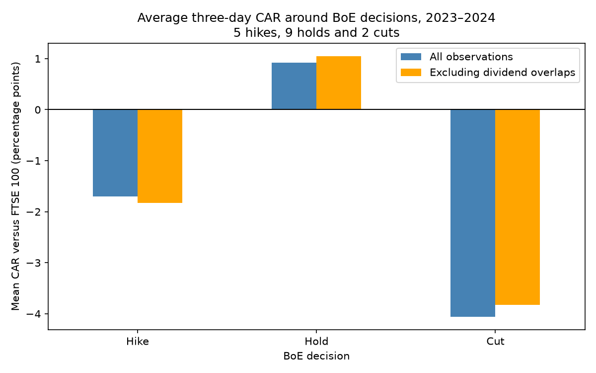
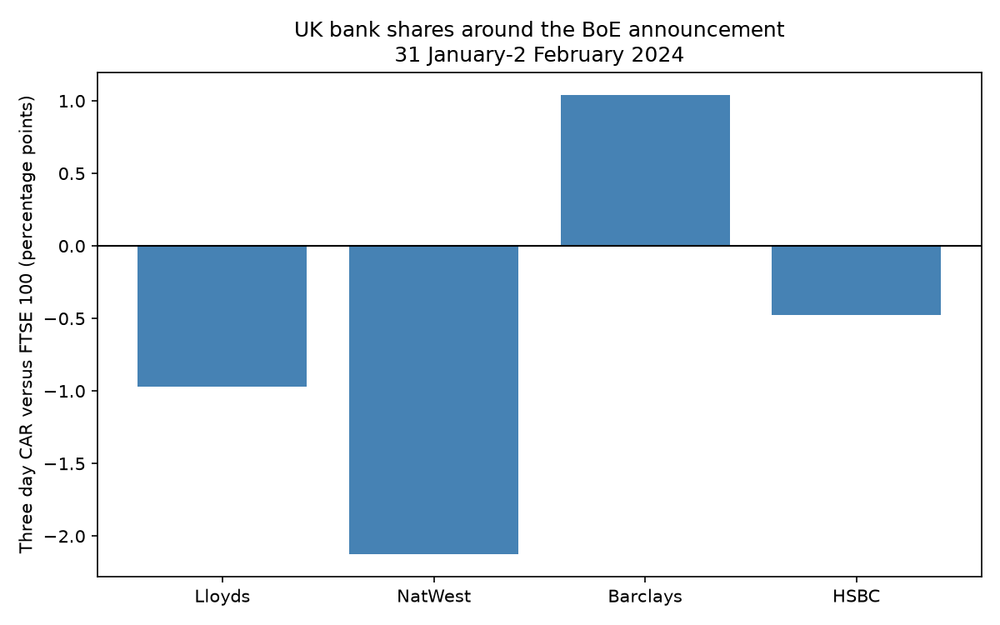
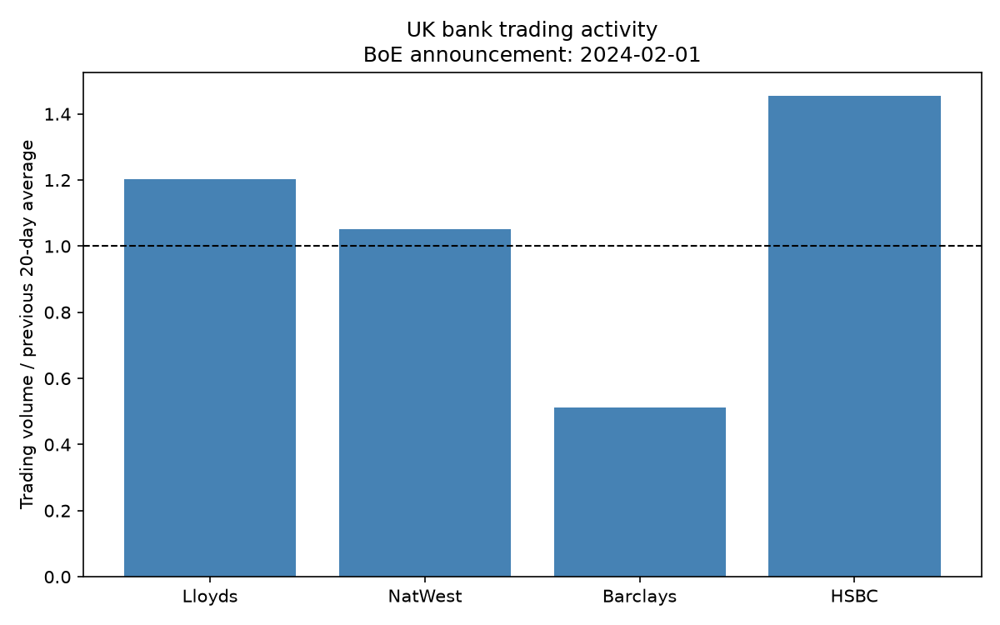

# Bank of England Decisions and UK Bank Stocks

## Research question

How do major UK listed banks react to Bank of England monetary policy announcements, and does the reaction differ depending on whether rates are raised, cut or held?

I started this project to explore the relationship between monetary policy and bank share prices while developing my Python and financial analysis skills and knowledge.

I broke the main question into three smaller questions:

- Do bank shares outperform or underperform the wider market around Monetary Policy Committee (MPC) announcements?
- Are the observed reactions different for rate hikes, cuts and holds?
- Do UK-focused banks react differently from more internationally diversified banks?

The current analysis focuses on the first two questions. The third is an exploratory hypothesis that motivated my choice of banks.

## Why these four banks?

I selected:

- **Lloyds**
- **NatWest**
- **Barclays**
- **HSBC**

These banks offer different business mixes and levels of international exposure. This provides a good starting point for exploring whether their responses to UK monetary policy news differ between them.

My initial hypothesis was that Lloyds and NatWest might react more strongly than HSBC because their businesses are more closely tied to the UK economy and UK interest rates. Barclays provides another perspective through its mix of UK banking and international activities.

This is a hypothesis, *not* an assumption that the results must support. The subsequent analysis below do not directly test it.

## Scope and data

The project covers all **16 scheduled BoE rate decisions in 2023–2024**:

- 5 hikes
- 9 holds
- 2 cuts

For each announcement, I examine the four banks relative to the **FTSE 100 price index**.

Daily closing prices, trading volumes and dividend information were downloaded from Yahoo Finance using `yfinance`. The download includes December 2022 to provide earlier observations for the volume calculations.

The sample contains **64 bank–announcement observations**. This represents 16 policy announcements, not 64 independent decisions.

## Method and choice of metrics

I used four measures to examine price movements and trading activity. Together, they show how each bank's shares moved, how that compared with the wider market, and whether the picture changed over a longer window, and how much trading took place.

### 1. Daily price return

**What it measures**

The percentage change in a bank's closing share price from the previous trading day's close:

Daily return (%) = ((today's close / previous trading day's close) − 1) × 100

For the FTSE 100, the same calculation uses index levels rather than share prices.

**Example from the data**

Barclays closed at 148.42p on 31 January 2024 and 146.04p on 1 February:

(146.04 / 148.42 − 1) × 100 = approximately −1.60%

This means Barclays' share price fell by approximately 1.60% between those two closing prices.

**Why I chose it**

Percentage returns make movements comparable across shares with different prices. A 2p movement has a much larger proportional effect on a 50p share than on a 500p share.

They also allow comparison with the FTSE 100, despite bank prices being quoted in pence and the index being measured in points using free-floated market capitalisation.

**What it cannot tell us**

A daily return does not explain why the price moved. It includes the effects of wider market conditions and company specific news, as well as any reaction to the BoE.


### 2. Announcement-day market-adjusted return

**What it measures**

How much a bank outperformed or underperformed the FTSE 100 on announcement day:

Market-adjusted return = bank daily return − FTSE 100 daily return

The result is expressed in **percentage points**, because it is the difference between two percentage returns.

**Example from the data**

On 1 February 2024:

- Barclays' return was approximately −1.60%.
- The FTSE 100's return was approximately −0.11%.
- Barclays' market-adjusted return was approximately −1.49 percentage points.

Calculation:

−1.60 − (−0.11) = −1.49 percentage points

Barclays therefore fell more than the wider-market benchmark that day.

**Why I chose it**

A bank's share price might fall on a day when the entire market is falling. Comparing it with a benchmark gives more context than looking at the share price change alone.

I chose the FTSE 100 because it is a familiar benchmark for large UK-listed companies, including the four banks studied.

**How to interpret it**

- Positive: the bank outperformed the FTSE.
- Negative: the bank underperformed the FTSE.
- Zero: the bank and FTSE had the same percentage return.

Outperformance does not necessarily mean the bank's price rose - falling less than the market also counts as outperformance.

**What it cannot tell us**

This is a simple comparison, not a complete adjustment for risk. It treats the FTSE return as the benchmark without estimating how sensitive each bank normally is to market movements.

It also does not isolate the BoE's effect: other news can cause a bank to perform differently from the market.

### 3. Three day cumulative abnormal return (CAR)

**What it measures**

CAR adds the daily market-adjusted returns over a three trading-day window:

- The trading day before the announcement
- The announcement day
- The following trading day

CAR = sum of the daily (bank return − FTSE 100 return)

Here, “abnormal” means relative to our chosen benchmark (which was 1). It does not mean the return has been shown to be statistically unusual.

**Example from the data**

For Barclays around the 1 February 2024 announcement:

| Date | Barclays return | FTSE return | Difference |
|---|---:|---:|---:|
| 31 January | −1.22% | −0.47% | −0.75 pp |
| 1 February | −1.60% | −0.11% | −1.49 pp |
| 2 February | +3.20% | −0.09% | +3.29 pp |

Using the underlying, unrounded data, Barclays' three-day CAR was **+1.04 percentage points**.

The rounded differences shown above sum to +1.05; that small discrepancy arises because the code purposely rounds only after performing the calculations.

Barclays underperformed on announcement day, but its relative gain the following day was large enough to produce a positive CAR across the full window.

**Why I chose it**

Looking only at announcement day could miss movements immediately before or after it.

The three day window allows us to examine possible anticipation and subsequent adjustment while keeping the period relatively short. It also allows us to reduce the effet of any abnormallity as the error interval is spread over three data points instead of one. Comparing CAR with the announcement day result also shows how sensitive the interpretation is to the chosen window.

**How to interpret it**

A positive CAR means the sum of the bank's daily returns exceeded the sum of the FTSE's daily returns over the window. A negative CAR means the opposite.

CAR is a sum of daily return differences, not a compounded investment return.

**What it cannot tell us**

Including additional days also includes additional opportunities for unrelated news to affect prices. A positive or negative CAR cannot, by itself, establish a causal reaction to the BoE decision.

The day before return runs from the preceding trading day's close to the day-before close. For this example, the full measurement window therefore starts at the close on 30 January and ends at the close on 2 February.

### 4. Relative trading volume

**What it measures**

How many shares traded on announcement day compared with the bank's recent daily average:

Relative volume = announcement-day volume / average volume over the previous 20 trading days

The announcement day trade volume is excluded from the average so that it does not influence its own comparison baseline.

**Example from the data**

On 1 February 2024:

| Bank | Relative volume | Interpretation |
|---|---:|---|
| Lloyds | 1.20× | Approximately 20% above its recent average |
| NatWest | 1.05× | Approximately 5% above its recent average |
| Barclays | 0.51× | Approximately 49% below its recent average |
| HSBC | 1.45× | Approximately 45% above its recent average |

HSBC therefore experienced the greatest proportional increase over its own recent average among these four banks that day. This does not necessarily mean it had the largest absolute number of shares traded.

**Why I chose it**

Price movements show changes in valuation, while volume adds information about trading activity.

Comparing each bank with its own average is more informative than comparing raw share counts between banks, because their normal trading volumes differ.

An unusually high volume may therefore suggest that investors were actively responding to new information and adjusting their holdings, although it cannot tell us whether the Bank of England’s announcement prompted those trades.

I chose 20 trading days as a simple baseline covering approximately one trading month. This is a practical choice rather than a uniquely correct comparison period.

**How to interpret it**

- Above 1×: more shares traded than the recent daily average
- Below 1×: fewer shares traded
- Equal to 1×: trading matched the average

A ratio of 1.45× means 45% above average, not 145% above average.

**What it cannot tell us**

High volume does not automatically indicate optimism or pessimism: every completed trade has both a buyer and a seller.

It also does not prove the announcement caused the activity. Company news, unusually quiet comparison periods or other events can affect the ratio.

### Dividend-overlap check

This is a data quality check rather than an additional performance metric.

On an ex-dividend date, new buyers no longer receive the upcoming dividend. The share price can therefore fall for a reason unrelated to monetary-policy news. This happens often.

The script flags a bank announcement observation if an ex-dividend date falls within its three day window. I then compare the full sample with a version excluding those flagged observations.

**Example from the data**

HSBC's market-adjusted return on 9 May 2024 was **−4.47 percentage points**, and its three-day CAR was **−3.70 percentage points**. That announcement coincided with HSBC's ex-dividend date.

It would therefore be disingenuous to interpret the entire price movement as a reaction to the BoE.

Across the sample, five observations were flagged. Excluding them increased the average CAR around holds from **+0.92 to +1.05 percentage points**, while leaving its direction positive.

This comparison checks whether the broad findings depend on those overlaps. It does not calculate dividend inclusive returns or remove every possible influence unrelated to monetary policy.

## Results



### All observations

| Decision | Mean announcement-day return minus FTSE (pp) | Mean three-day CAR (pp) | Mean relative volume | Observations |
|---|---:|---:|---:|---:|
| Hike | −0.41 | −1.71 | 1.42× | 20 |
| Hold | +0.39 | +0.92 | 1.20× | 36 |
| Cut | −3.11 | −4.06 | 1.41× | 8 |

### Excluding dividend overlaps

| Decision | Mean announcement-day return minus FTSE (pp) | Mean three-day CAR (pp) | Mean relative volume | Observations |
|---|---:|---:|---:|---:|
| Hike | −0.37 | −1.83 | 1.39× | 18 |
| Hold | +0.53 | +1.05 | 1.21× | 35 |
| Cut | −3.21 | −3.83 | 1.23× | 6 |

*pp = percentage points. Each bank–announcement observation receives equal weight.*

## What I found

In this sample, holds coincided with positive average three day performance relative to the FTSE, while hikes and cuts coincided with negative averages.

Removing the dividend overlaps did not change the direction of average CAR in any category. Those overlaps therefore do not explain the entire pattern. However, excluding them also changes which banks contribute to each average.

The cut results require particular care: there were only two cut announcements in this whole data set. The August 2024 window showed much larger negative CARs than November, illustrating how a small number of events can influence the overall average.

Average relative trading volume exceeded 1× in every category. This indicates above-average activity across the observations collectively, but does not mean every announcement had unusually high volume or that the BoE caused that activity, but it could hint to that prediction.

## Example: 1 February 2024

Barclays underperformed the FTSE by **1.49 percentage points** on announcement day, but its three day CAR was **+1.04 percentage points** following a rebound the next day.

This illustrates why the measurement window matters.





## Limitations

- **Small sample:** only 16 announcements, including two cuts.
- **Other events:** earnings announcements, speculation, economic releases and international market shocks can affect prices during the same windows.
- **Market expectations:** decisions may already be anticipated. The project does not measure the unexpected component of a decision.
- **Daily data:** the closing prices we used to compare included movements before and after the announcement.
- **Simple market adjustment:** subtracting the FTSE return does not account for different sensitivities to market movements. The banks are also part of the FTSE 100. Its not an isolating variable.
- **Dividend treatment:** flagging ex-dividend overlaps does not turn price returns into total returns.
- **Related observations:** the four banks share exposure to common events, so their results are not independent.
- **Descriptive results:** averages can be influenced by large observations, and no statistical significance tests were performed.
- **International exposure:** the initial hypothesis about UK focused versus international banks has not yet been directly tested.

These findings describe this sample; they do not establish that rate decisions caused the observed returns.

## What I learned

I practised downloading financial data, working with pandas tables, writing loops and functions, and creating charts with Matplotlib.

The project also helped me understand why financial analysis needs careful interpretation. Benchmark choice, event windows, dividend dates and sample size can all affect the conclusions drawn from the same data. It also gave me an opportunity to learn what all of those terminology actually mean too.

## How to run

Install the packages:

```bash
python -m pip install yfinance pandas matplotlib
```

Run the script:

```bash
python analysis.py
```

The script downloads the data, prints the calculations and summaries, saves `results.csv`, and creates three chart images.

Close each chart window to let the script continue to the next one. An internet connection is required. Historical data may change if the provider revises it.

## Sources

- [Bank of England monetary policy summaries and minutes](https://www.bankofengland.co.uk/monetary-policy-summary-and-minutes)
- [Yahoo Finance](https://finance.yahoo.com/)
- [yfinance documentation](https://ranaroussi.github.io/yfinance/)
- [Lloyds dividend history](https://www.lloydsbankinggroup.com/investors/shareholder-information/dividends.html)
- [HSBC dividend information](https://www.hsbc.com/investors/shareholder-and-dividend-information/dividend-information-and-timetable)